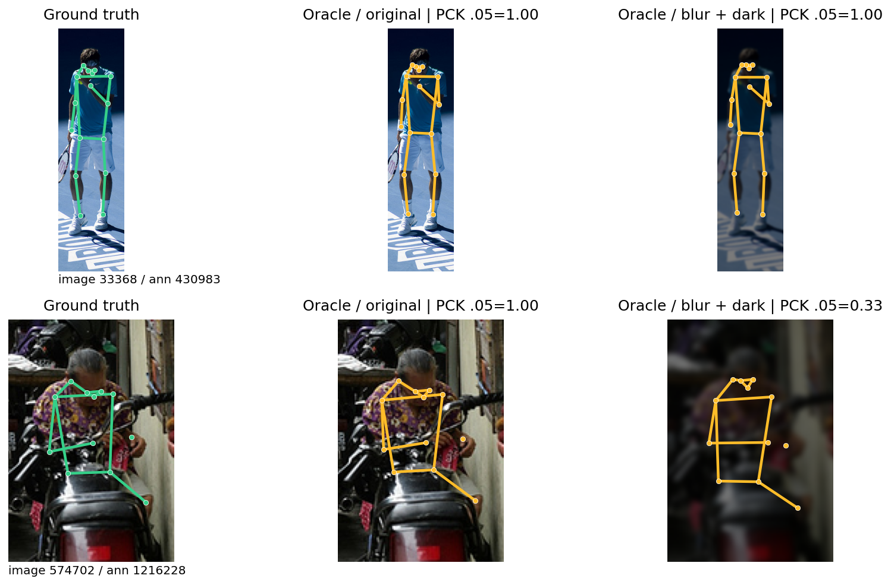
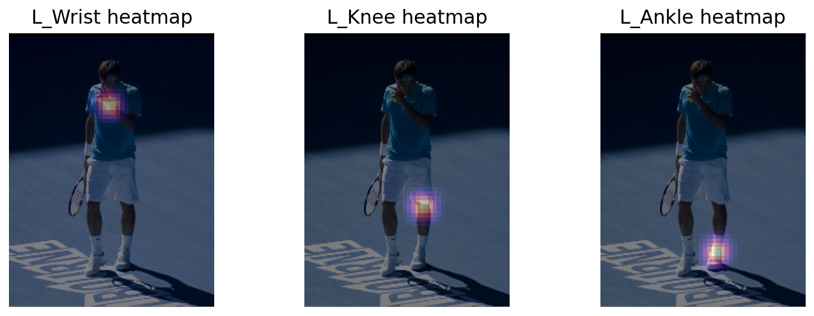
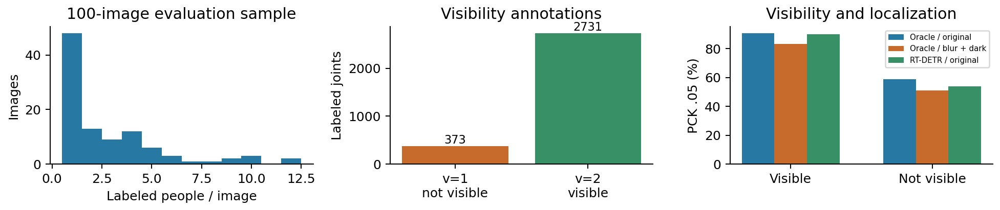
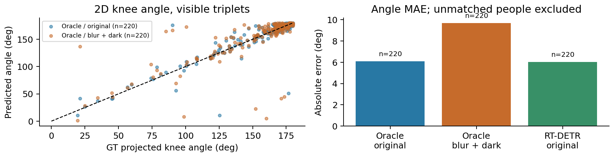
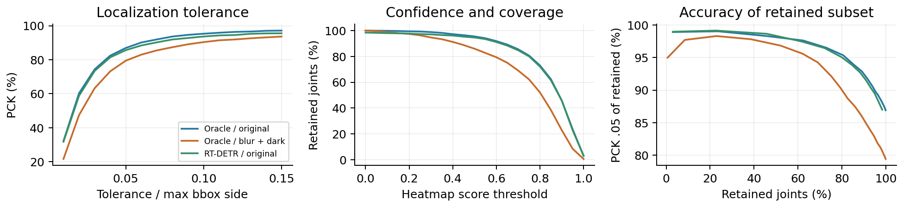
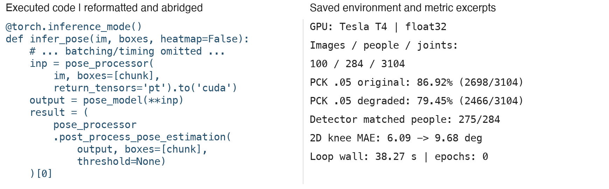

# ViTPose 2D 자세 추정과 입력 조건 비교

9주차 자세 추정 수업을 바탕으로 Hugging Face의 **ViTPose base simple**을 Colab Tesla T4에서 실행했다. COCO val2017의 CC BY 2.0 이미지 100장·284명에서 17개 키포인트와 골격을 추출하고, 영상 열화·사람 검출 단계·2D 무릎 각도의 영향을 확인했다.

**추가 학습은 수행하지 않았다.** 같은 사전학습 가중치를 고정한 추론 실험이다. COCO 검증셋 일부를 이용한 점검이며 새 카메라나 실제 운동 서비스에 대한 독립 검증이 아니다.

## 실제 결과

| 조건 | PCK_bbox@0.05 ↑ | PCK_bbox@0.10 ↑ | 보이지 않는 주석점의 PCK@0.05 ↑ | 2D 무릎 각도 MAE ↓ |
|---|---:|---:|---:|---:|
| 정답 박스·원본 영상 | 86.92% | 95.30% | 58.98% | 6.09° |
| 같은 정답 박스·흐림+어두움 | 79.45% | 90.37% | 51.21% | 9.68° |
| RT-DETR 검출 박스·원본 영상 | 85.63% | 93.65% | 53.89% | 6.02° |

원본과 열화 조건의 정확한 PCK@0.05 분자는 **2698/3104와 2466/3104**다. 7.47%p 낮아졌다. 검출 박스 조건은 2658/3104이며 284명 중 **275명**이 정답 사람과 연결됐다. 두 입력 조건은 같은 100장·284명의 쌍으로, 독립 표본 200장으로 세지 않는다.



위 행은 충분한 관절 주석과 크기 조건을 만족한 사람 중 원본 PCK의 중앙 순위 사례, 아래 행은 원본 대비 열화 PCK 하락이 가장 큰 사례다. 사람 선택 규칙과 ID는 `results/selected_examples.json`에 있다. 그림은 전체 평균만으로 드러나지 않는 오류를 설명하기 위한 사후 선택이다.

## 수업 개념과 실험의 연결

- **관절과 골격:** 코·눈·귀·어깨·팔꿈치·손목·엉덩이·무릎·발목의 17점과 체크포인트의 연결 규칙을 사용했다. 모든 점을 서로 잇지 않는다.
- **Top-down:** 사람 박스를 먼저 얻고 각 박스에서 자세를 추정한다. 원본 정답 박스는 사람 위치를 이미 아는 oracle 조건이다. 실제 검출기와 연결한 조건을 별도로 두었다. Bottom-up 모델을 실행하거나 두 구조의 속도를 비교한 실험은 아니다.
- **히트맵:** ViT 특징에서 17개 64×48 응답 맵을 만들고 체크포인트 processor의 후처리로 원본 영상 좌표를 복원했다. 히트맵의 최댓값은 보정된 확률이 아니다.
- **입력 품질·가림:** Gaussian blur 반경 2픽셀과 밝기 0.5를 함께 적용했다. 두 요인의 개별 인과효과는 분리하지 않았다. `v=1`은 주석은 있지만 보이지 않는 점, `v=2`는 보이는 주석점이다.
- **자세에서 분석으로:** 엉덩이–무릎–발목의 2D 투영 각도를 계산했다. 단일 사진에서 얻은 2D 각도는 깊이 정보가 있는 해부학적 관절각이나 3D 자세를 대신하지 않는다. 행동 인식·반복 횟수·낙상 판단도 이번 실험에 포함하지 않았다.



## 데이터와 평가 대상

공식 [COCO 다운로드](https://cocodataset.org/#download)의 `annotations_trainval2017.zip`에서 `person_keypoints_val2017.json`을 읽었다. [공식 S3 버킷](https://s3.amazonaws.com/images.cocodataset.org/annotations/annotations_trainval2017.zip)을 이용하며, 원본 영상을 COCO `val2017/`에서 선택적으로 받는다.

1. 이미지 라이선스 ID 4(CC BY 2.0)이며, crowd가 아니고 주석 관절 5개 이상·박스 면적 1024픽셀² 이상인 사람이 한 명 이상 있는 이미지 392장을 후보로 삼았다.
2. 정렬한 후보 ID에서 Python `random.Random(42).sample(...,100)`으로 100장을 고른 뒤 다시 ID순으로 처리했다.
3. 선택한 이미지 안의 모든 noncrowd 사람 중 `num_keypoints>0`, 박스 폭·높이가 양수인 284명을 평가했다. 후보를 만들 때의 5점·크기 조건을 최종 사람 평가에는 다시 적용하지 않았다.
4. 총 4828개의 관절 슬롯 중 `v=0`인 1724점은 제외했다. **보이는 점 2731개와 보이지 않는 주석점 373개**, 합계 3104점이 위치 평가의 분모다.

`data/manifest.json`에 전체 선택 ID, 대상 주석, 이미지별 SHA-256, 원본 URL·라이선스와 annotation JSON 해시가 있다. 원본 전체 annotation ZIP, 영상 파일, 모델 가중치는 저장소에 넣지 않았다. 그림에 사용한 사진의 출처·변경 내용은 [THIRD_PARTY_NOTICES.md](THIRD_PARTY_NOTICES.md)에 기록했다.



이 표본은 라이선스·크기·주석 조건으로 제한됐다. 전체 COCO 분포를 대표하는 무작위 표본이나 별도 현장 테스트셋으로 해석하지 않는다. 모델 개발·선택 과정에 COCO 검증셋이 활용됐을 가능성도 있어 완전히 낯선 데이터에 대한 성능을 주장하지 않는다.

## 지표 정의와 비교의 한계

**PCK_bbox@t:** 정답 박스의 긴 변 `max(width,height)`으로 정규화한 키포인트의 유클리드 오차가 `t` 이하이면 정답으로 센다. `v>0`인 전체 관절을 동일 가중치로 합산했다. 사람별 비율을 단순 평균하지 않았다. PCKh, OKS, COCO keypoint AP와 다른 자체 명시 지표이며 이 수치를 공식 AP로 부르지 않는다.

검출 박스는 RT-DETR person score≥0.3으로 얻는다. 점수 내림차순으로 아직 연결되지 않은 정답 중 IoU가 가장 높은 사람에 연결하되 IoU≥0.5여야 한다. 연결하지 못한 **정답 사람의 관절은 PCK에서 오답**이다. 545개 검출 박스 중 275개가 평가 대상에 연결됐다. 나머지를 모두 오탐으로 부르지 않는다. `num_keypoints=0`인 사람·crowd·미주석 인물이 있을 수 있다. 이 지표는 검출 누락을 반영하지만 **추가 검출의 오탐을 벌점으로 반영하지 않으며**, 완전한 end-to-end 검출 AP가 아니다.

**무릎 각도:** `u=hip−knee`, `v=ankle−knee`, `θ=acos((u·v)/(|u||v|))`를 사용했다. 세 GT 관절이 모두 `v=2`인 좌우 무릎 총 **220개**에서 MAE를 구했다. 점수에 따른 제외는 하지 않았고, 퇴화한 선분·누락된 예측은 제외하되 평가 개수를 따로 기록한다. 이번에는 세 조건 모두 220개였다. 보이지 않는 무릎과 검출되지 않은 사람의 전체적인 각도 성능을 보장하지 않는다. 검출 조건의 0.07° 차이는 개선의 근거로 일반화하지 않는다.



**점수와 coverage:** 고정된 0~1 점수 격자에서 남는 관절 비율과 남은 관절만의 PCK를 함께 그렸다. 점수를 높여 낮은 점수 관절을 버린 결과는 전체 모델이 좋아진 것과 다르다. 이 표본으로 운영 임계값을 선택하지 않았다.



## 모델과 실제 실행 환경

| 항목 | 설정 / 실제 값 |
|---|---|
| 자세 모델 | [`usyd-community/vitpose-base-simple`](https://huggingface.co/usyd-community/vitpose-base-simple), 85,912,337 parameters |
| 자세 모델 revision | `a93ac0c67e0b7e2c55287d21d4c460c8f3c54d45` |
| 검출 모델 | [`PekingU/rtdetr_r50vd_coco_o365`](https://huggingface.co/PekingU/rtdetr_r50vd_coco_o365) |
| 검출 모델 revision | `457857cec8ac28ddede40ecee9eed2beca321af8` |
| 입력 / 출력 | 박스별 affine crop 높이×너비 256×192 / 17채널·높이×너비 64×48 heatmaps → 원본 좌표 |
| 학습 | 없음, 모든 가중치 고정, 0 epoch |
| 연산 | float32, pose batch 최대 8, flip test 없음 |
| GPU | Google Colab Tesla T4, 메모리 15,637,086,208 bytes |
| 환경 | Python 3.13.16, torch 2.11.0+cu130, torchvision 0.26.0+cu130, transformers 4.57.1 |
| 전체 추론 루프 | 38.27초, 이미지 로딩·열화·3조건 추론·후처리·히트맵 저장 포함 |
| 부분 측정 | pose 전처리 13.54초, GPU forward 9.84초, pose decode 3.02초, detector 7.76초 |
| 측정 제외 | 패키지 설치, 데이터·모델 다운로드, 모델 로딩, 워밍업, 후속 지표 집계·도표 생성 |

부분 시간은 세 조건을 합친 누적값으로 단일 사람·단일 프레임의 운영 지연이 아니다. 전체 루프에는 이 네 항목 밖의 영상 읽기·열화·히트맵 파일 저장도 있어 부분 합계와 차이가 난다. 가중치를 바꾸지 않았으므로 학습 손실·학습 전후 개선·수렴을 측정하지 않았다.



## 재현

[Colab 노트북](notebooks/colab_pose_estimation.ipynb)을 GPU 런타임에서 실행하거나, CUDA PyTorch가 설치된 환경에서 아래를 실행한다. 공개 모델이라 이번에는 Hugging Face 토큰을 사용하지 않았다.

```bash
python -m pip install -r requirements.txt
export VISIONAI_ROOT="$PWD"
python experiments/pose_experiment.py
python experiments/analyze_and_plot.py
python experiments/verify_results.py
```

`requirements.txt`는 이번 환경의 분석·모델 패키지를 고정했다. PyTorch/torchvision은 실행 플랫폼에 맞게 설치해야 하며 실제 사용 버전은 위 표와 `results/environment.json`에 있다. COCO 원본 annotation ZIP은 약 250MB이며 최초 실행에서 받는다. 모델·데이터가 같아도 GPU·라이브러리 차이로 경계 근처의 결과가 조금 달라질 수 있다.

이미 저장된 지표의 독립 점검은 GPU나 모델 다운로드 없이 Python 표준 라이브러리로 가능하다.

```bash
python experiments/verify_results.py
```

`analyze_and_plot.py`만 실행해 기존 좌표로 도표를 재생성할 수도 있다. 필요한 예시 이미지 두 장은 manifest의 해시를 검증하며 내려받고, 해당 이미지의 실제 저장 히트맵은 `results/heatmaps_*.npz`에 있다. 모델 카드 캡처와 편집된 코드 발췌 그림은 보관된 문서용 이미지다.

### 이번 실행의 Colab CLI 경로

```bash
colab new -s visionai-week9-pose --gpu T4
# 새 VM에서 requirements의 패키지를 먼저 설치한다.
colab exec -s visionai-week9-pose -f experiments/pose_experiment.py --timeout 1500
colab exec -s visionai-week9-pose -f experiments/analyze_and_plot.py --timeout 400
# 결과를 ZIP으로 묶어 download로 회수한 뒤 종료한다.
colab stop -s visionai-week9-pose
colab sessions
```

실제 결과를 회수한 후 세션 종료와 활성 세션 없음까지 확인했다. 개인 로그인 정보·강의 전사본·제출용 보고서는 이 저장소에 포함하지 않았다.

## 적용 아이디어와 다음 검증

운동 영상에서 관절각 변화와 반복 횟수를 표시하는 **피트니스 코칭 보조**에 연결할 수 있다. 이번 실험은 사진의 2D 각도만 계산했으므로 스쿼트의 올바름, 부상 위험, 행동 유형을 판정한 결과는 아니다. 카메라 각도·가림·사람 크기를 달리한 독립 영상에서 좌표 흔들림, 각도 오차, 사용 가능한 프레임 비율, 반복 횟수 오차를 검증해야 한다. 저신뢰 프레임은 무리하게 수치를 표시하지 않고 사용자 재촬영이나 검토로 연결한다.

## 자료와 출처

- [ViTPose 모델 카드](https://huggingface.co/usyd-community/vitpose-base-simple), [RT-DETR 모델 카드](https://huggingface.co/PekingU/rtdetr_r50vd_coco_o365): 두 카드 모두 Apache-2.0 표기.
- [Transformers ViTPose 문서](https://huggingface.co/docs/transformers/model_doc/vitpose): 박스 입력과 히트맵 좌표 후처리.
- [ViTPose 논문](https://arxiv.org/abs/2204.12484), [공식 구현](https://github.com/ViTAE-Transformer/ViTPose).
- [COCO 데이터 형식](https://cocodataset.org/#format-data), [다운로드](https://cocodataset.org/#download), [이용 조건](https://cocodataset.org/#termsofuse).
- 제공된 9주차 Pose Estimation 강의자료와 강의 전사본은 개념·실습 범위를 정하는 데 참고했으며 재배포하지 않았다.

코드 구현, 자료 대조, Colab 실행, 결과 검증, 보고서 문장 작성에는 Codex의 도움을 받았다. 실험 수치는 저장된 실제 GPU 좌표와 로그에서 계산했다.
